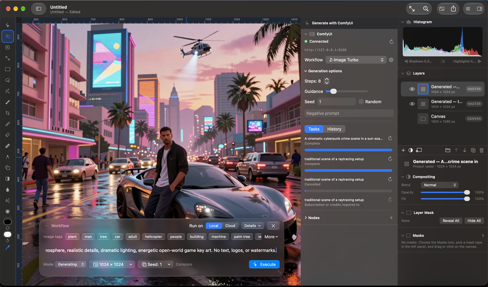
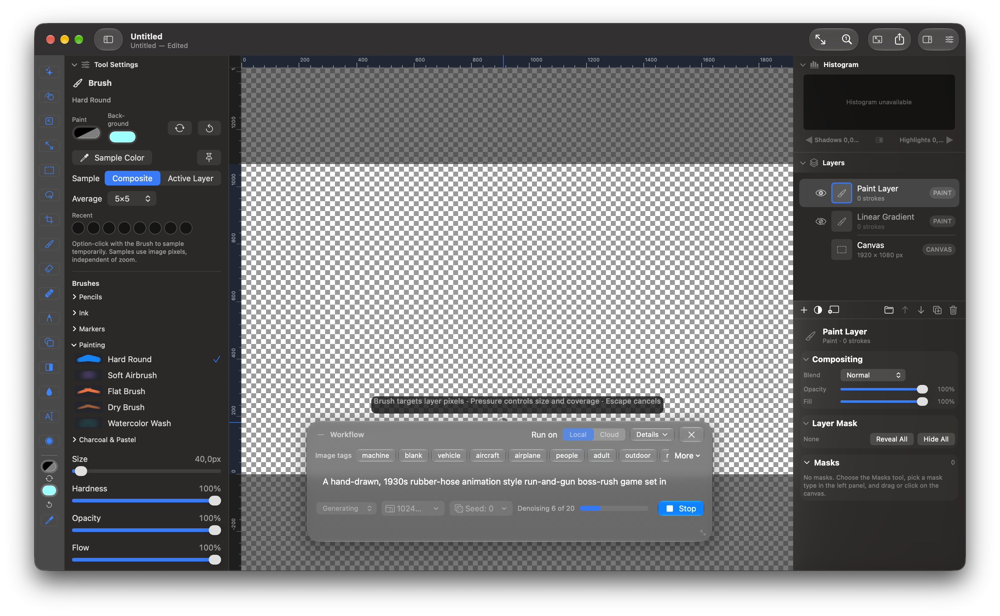
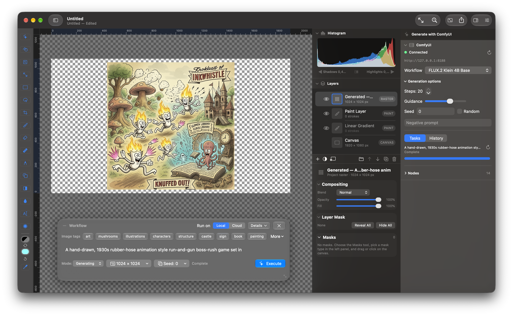
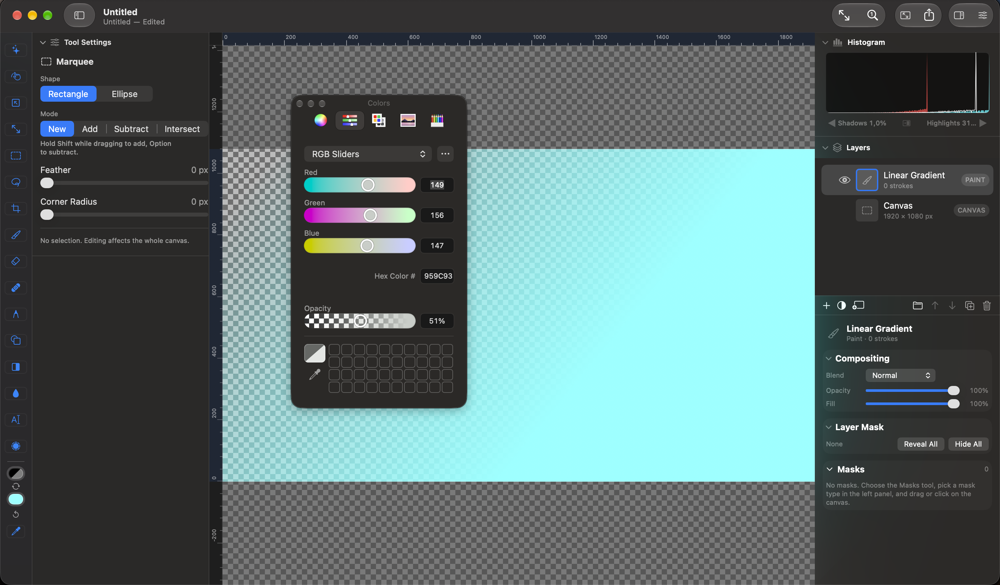

# Pixeltje Mac

Pixeltje Mac is a native Swift 6 application for macOS 27. It develops
camera RAW files with Apple's public `CIRAWFilter` API, composes layers in a
native editor, and renders through Metal-backed Core Image. A companion
Pixeltje Pipeline app authors and runs typed `*.pixpipeline.json` workflows.

<p align="center">
  <a href=".github/images/comfyui-generation.png"></a>
  <a href=".github/images/brush-generation-progress.png"></a>
  <a href=".github/images/flux2-klein-result.png"></a>
  <a href=".github/images/marquee-colors.png"></a>
</p>

The active external generation path connects to a user-managed ComfyUI server.
Core AI workflows are a separate, in-process pipeline under development. Models
and source images are linked from the user's machine; model weights are not
included in this repository.

ComfyUI is a trademark of Comfy Org. Pixeltje is an independent integration
and is not affiliated with or endorsed by Comfy Org.

## Requirements

- macOS 27 and Xcode 27 with the macOS 27 SDK
- SwiftPM (included with Xcode)
- Apple silicon for Core AI model execution

Open `Package.swift` in Xcode, or build from the repository root:

```sh
swift build
./Scripts/check-independence.sh
```

If your selected command-line tools do not match Xcode's SDK, prefix Swift
commands with `DEVELOPER_DIR=/Applications/Xcode.app/Contents/Developer` (or
the path to your installed Xcode). This project's local development machine
uses Xcode beta; see [AGENTS.md](AGENTS.md) for its exact commands.

Run the editor with a camera file, project, folder, or blank canvas:

```sh
swift run PixeltjeMacApp "/path/to/photo.RAF"
swift run PixeltjeMacApp "/path/to/shoot"
swift run PixeltjeMacApp --size 1024x1024
```

Run the companion Pipeline app with an example workflow:

```sh
swift run PixeltjePipeline "Examples/default.pixpipeline.json"
```

Unit tests use `swift test`. GitHub Actions builds and tests an isolated copy
of the tracked source on an Xcode 27 runner.

## Documentation

- [Model setup guide](Documentation/UserGuide/Model-Setup-Guide.html)
- [Base Test Set examples](Examples/BaseTestSet/README.md)
- [Third-party notices](THIRD_PARTY_NOTICES.md)

[AGENTS.md](AGENTS.md) records the architecture and contribution constraints.
Third-party example material retains its own notices in the relevant source
files.

## License

Pixeltje Mac is released under the [MIT License](LICENSE), except for material
identified in the [third-party notices](THIRD_PARTY_NOTICES.md).
